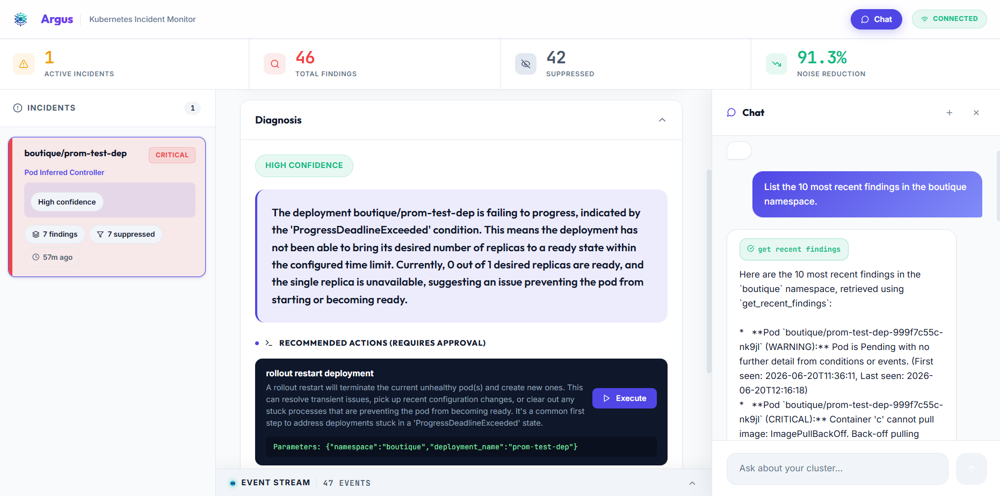

# Argus

Argus is an automated Kubernetes triage and monitoring platform. It monitors cluster states, correlates raw failure warnings into single incidents to reduce alert noise, and leverages an autonomous agent to diagnose root causes and suggest remediations.

For a detailed walkthrough of the internal technical details and pipeline data flow, see [how-it-works.md](docs/how-it-works.md).

<p align="center">
  
</p>

<p align="center">
  &nbsp;
  &nbsp;
  &nbsp;
  &nbsp;
  
</p>

---

## Key Features

* **Real-Time Watchers:** Continuously monitors pod crashloops, resource events, endpoint counts, and Prometheus metrics.
* **Incident Correlation:** Evaluates raw warnings against 5 hierarchical correlation rules to group related failures (e.g., node, controller, or service-level issues) into single actionable incidents.
* **Agentic Triage:** Uses a LangGraph agent loop (powered by Gemini) to execute read-only diagnostics (logs, event checks, config reviews) and output structured remediation plans.
* **Manual Approvals:** Provides interactive buttons on the web dashboard to safely execute agent-proposed remediations (e.g., restarts, scaling) via a whitelisted execution gateway.
* **API Key Rotation:** Automatically switches between a pool of configured Gemini API keys to handle rate limits and quota exhaustions transparently.

---

## Project Structure

* `triggers/`: Background threads watching Kubernetes events, pods, and Prometheus.
* `snapshot/`: Targeted state capture engine for failing resources.
* `analyzers/`: 12 stateless Python analyzers mapping resource states to warnings.
* `engine/`: Core correlation engine, LangGraph triage agent, and action executor.
* `agent/`: Interactive CLI conversation agent loop.
* `frontend/`: React dashboard interface.
* `tests/`: End-to-end integration and cluster simulation tests.
* `deploy/terraform/`: Terraform configuration that deploys Argus inside a cluster.

---

## Setup & Installation

### Prerequisites
* Python 3.12+
* Node.js 18+ and npm
* Minikube running locally
* Prometheus installed in the cluster (e.g., `prometheus-server`)
* One or more Google Gemini API keys

### Installation
1. Clone the project and navigate to the directory:
   ```bash
   cd Argus
   ```
2. Create and activate a Python virtual environment:
   ```bash
   python -m venv venv
   # Windows:
   .\venv\Scripts\Activate.ps1
   # Linux/macOS:
   source venv/bin/activate
   ```
3. Install Python dependencies:
   ```bash
   pip install -r requirements.txt
   ```
4. Install frontend dependencies and build the UI:
   ```bash
   cd frontend
   npm install
   npm run build
   cd ..
   ```
5. Copy the environment template and configure your API keys:
   ```bash
   cp .env.example .env
   # Open .env and add your GOOGLE_API_KEY
   ```

---

## Running the Application

1. **Start Minikube**:
   ```bash
   minikube start
   ```
2. **Port-forward Prometheus** to port 9090 (run in a separate terminal):
   ```bash
   kubectl port-forward svc/prometheus-server 9090:80 -n default
   ```
3. **Launch the Dashboard & Watcher**:
   ```bash
   python dashboard_main.py
   ```
   Open your browser and navigate to [http://localhost:8080](http://localhost:8080) to view the UI.
4. **Launch the CLI Chat Agent**:
   ```bash
   python -m agent
   ```

To run Argus inside the cluster instead, see [deploy/terraform](deploy/terraform/README.md).

---

## Running Tests
To execute the live cluster simulation test suite on Windows, run:
```powershell
$env:PYTHONIOENCODING="utf-8"
python tests/test_full_pipeline.py
```
