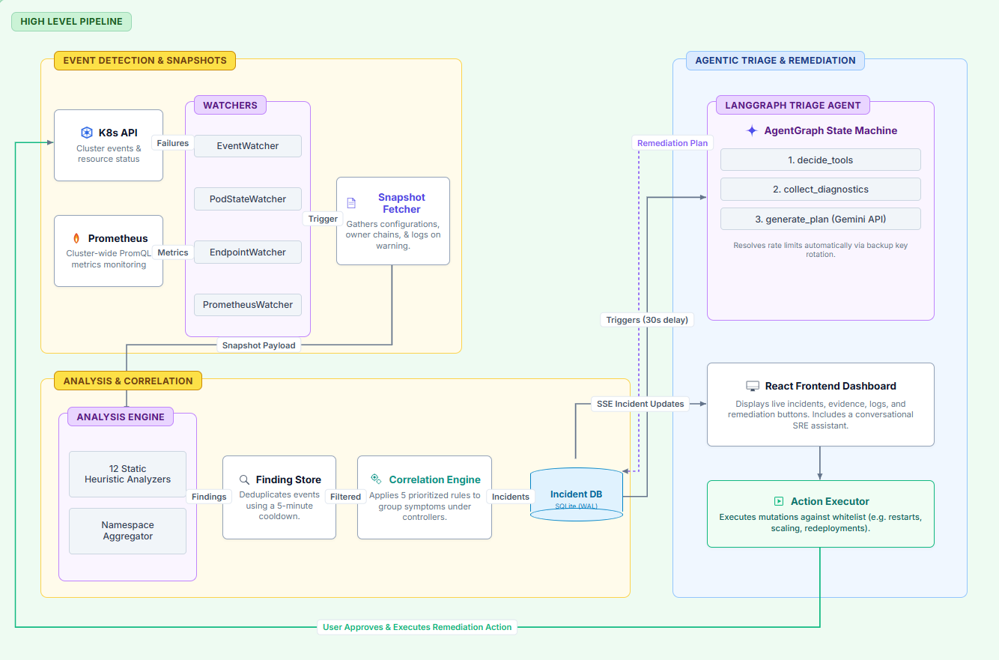
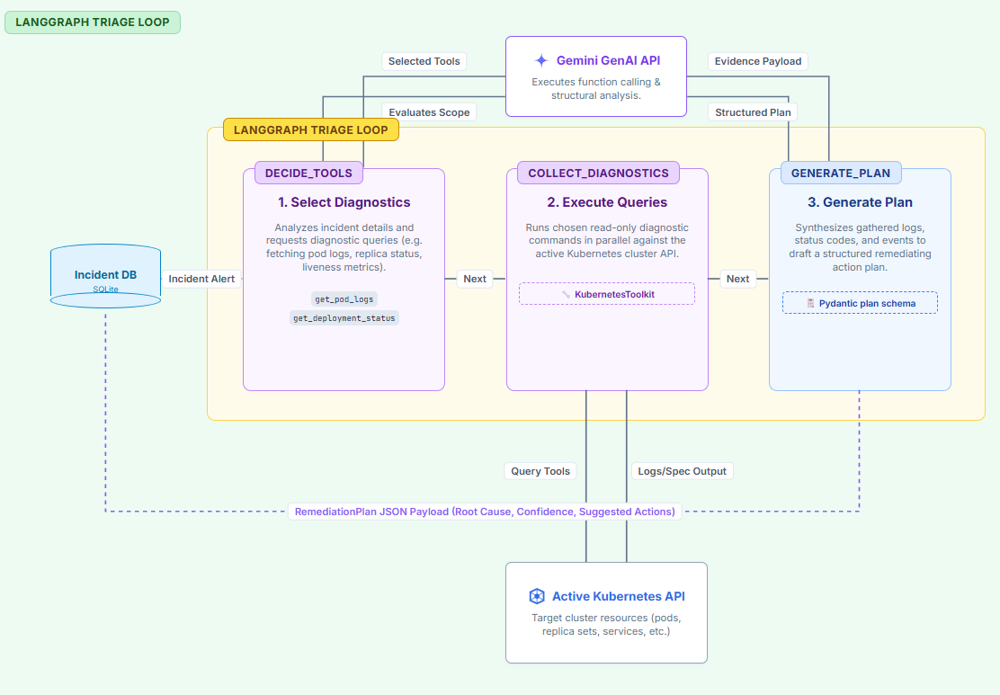

# How It Works

This document walks through the internal technical architecture of **Argus** — how events enter the system, how they get analyzed and correlated, and how the LangGraph agent diagnoses and helps remediate cluster incidents.

---

## Architecture Overview

The system is built on a **unidirectional data pipeline** that decouples fast event detection from expensive AI diagnostics:

  

---

## Phase 1: Detection

Four watchers run in parallel background threads to capture failures in real-time:

### 1. EventWatcher
Listens to the Kubernetes Events API, filtering for `Warning` events. When a warning arrives (e.g., `BackOff`, `FailedScheduling`, `Unhealthy`), it triggers the snapshot fetcher. It auto-reconnects on timeout or API drops.

### 2. PodStateWatcher
Watches the Pod API. It tracks the `Ready` condition. When a pod transitions from `Ready` to `NotReady`, it triggers the pipeline. This catches silent failures (e.g., failing liveness probes) that do not generate standard warning events.

### 3. EndpointWatcher
Watches Endpoint objects. It tracks the number of ready addresses. If a Service drops from one or more ready endpoints to `0`, it triggers. This catches traffic routing failures before the pod itself might be restarted or deleted.

### 4. PrometheusWatcher
Polls Prometheus every 30 seconds using 5 PromQL queries. To avoid spam, each query has a per-resource cooldown of 120 seconds.
* **Endpoint Gone:** `kube_endpoint_address_available == 0`
* **Deployment Unavailable:** `min_over_time(unavailable_replicas[5m]) > 0` (5m window prevents noise during rolling rollouts).
* **StatefulSet Degraded:** `ready / spec < 1`
* **Restart Rate Spike:** `rate(restarts[5m]) * 300 > 3` (Fires on 3+ restarts).
* **Memory Pressure:** `avg_over_time(working_set/limit[5m]) > 0.95`

---

## Phase 2: Analysis & Correlation

All watchers route warnings to `handle_warning()` inside `main.py`:

### Snapshot Fetching
Argus fetches a live snapshot of the failing resource before it restarts or changes. The snapshot includes:
* Live resource specification and status (via Kubernetes API).
* Recent event logs for the resource.
* The container logs (last 100 lines) if the resource is a Pod.
* The owner chain (e.g., `Pod` $\rightarrow$ `ReplicaSet` $\rightarrow$ `Deployment`).

### Static Analyzers
Argus runs the snapshot through a registry of 12 stateless analyzers (e.g., `PodCrashLoopAnalyzer`, `PVCAnalyzer`, `VolumeMountAnalyzer`). These output standardized `Finding` objects containing a severity, machine-readable reason, and context snippet.

### Namespace Aggregation
If $\ge3$ findings of the same failure type occur in the same namespace within 60 seconds, the `NamespaceAggregator` emits an aggregated namespace warning.

### Deduplication
The `FindingStore` filters findings using a 5-minute cooldown. If a finding (same resource, analyzer, and reason) is already in the database and was updated within the last 5 minutes, it is suppressed (incrementing a `suppressed_count` metric) to prevent log spam.

### Correlation Engine (Noise Reduction)
The correlation engine groups the filtered findings into incidents by evaluating 5 prioritized rules:
1. **Rule 0 (Controller Inference):** If $\ge2$ pod findings share the same owner, they are grouped under a single controller-level incident (e.g., `Deployment boutique/cartservice failing`) and the pod warnings are suppressed as symptoms.
2. **Rule 1 (Owner Dominance):** If a parent controller (Deployment/StatefulSet) is already marked as failing, it dominates and suppresses all child pod warnings.
3. **Rule 2 (Node Dominance):** If a Node goes down (e.g., `NodeNotReady`), it suppresses all pod warnings on that specific node.
4. **Rule 3 (Namespace Aggregation):** If namespace aggregation fired, it creates a namespace-level incident and suppresses individual pod warnings.
5. **Rule 4 (Standalone Escalation):** Escales critical findings (like `NoEndpoints` or `ZeroAvailableReplicas`) that were not covered by rules 0-3. It applies cross-resource deduplication to link related failures (e.g., Service failure + Deployment failure).

---

## Phase 3: Agentic Triage (LangGraph)

Exactly 30 seconds after an incident is created, a background thread starts the AI triage. The 30-second delay allows the cluster to stabilize and the correlation engine to group all symptoms.

We use **LangGraph** to execute a strict, structured state machine:

  

1. **decide_tools:** Gemini selects read-only diagnostic tools (`get_pod_logs`, `get_pod_events`, `list_pods`, `get_deployment_status`) to investigate the specific incident.
2. **collect_diagnostics:** The `KubernetesToolkit` executes these tools against the cluster and collects the evidence.
3. **generate_plan:** Gemini receives the evidence and generates a structured `RemediationPlan` model containing:
   * `root_cause`: Comprehensive explanation of the root cause.
   * `confidence`: High, Medium, or Low.
   * `suggested_actions`: List of concrete mutations (e.g., `restart_pod`, `scale_deployment`).

The resulting plan is stored as JSON in the database and immediately pushed to the dashboard via SSE.

---

## Phase 4: Action Execution & API Key Rotation

### Action Executor
When the LLM suggests remediation actions, they display as interactive buttons on the UI. Clicking "Execute" sends a request to `/api/actions/execute`.
The `ActionExecutor` validates the action name and parameters against a strict security whitelist before executing the mutation (e.g., triggering a rollout restart or scaling a replica).

---

## Database Schema

Argus uses a single SQLite database (`data/aiops.db`) in WAL (Write-Ahead Log) mode:
* **`findings`**: Raw warnings containing resource paths, messages, owner chains, and log snippets.
* **`incidents`**: Correlated incident groups. The `diagnosis` column stores the Pydantic JSON plan generated by LangGraph.
* **`incident_findings`**: Junction table mapping findings to incidents with roles (`ROOT_CAUSE`, `SYMPTOM`, `CONTRIBUTING`, or `RELATED`).
* **`chat_sessions` & `chat_messages`**: Stores SRE chat conversation history (with rolling summaries when conversations exceed 24 messages).

---

## Limitations & Future Work

While Argus is a functional and responsive AIOps dashboard, there are several architectural limitations in its current implementation along with opportunities for future expansion:

### Current Limitations
1. **API Rate & Quota Limits:** The free tier of the Gemini API limits daily usage. Although the client supports rotating fallback keys, a heavy wave of cluster alerts can still exhaust the available key pool.
2. **Single-Namespace Correlation Focus:** The correlation rules are optimized for resources within individual namespaces. The engine does not correlate cluster-wide infrastructure failures (such as global CoreDNS failures or ingress controller issues) across multiple namespaces.
3. **SQLite Database Single Instance:** Using a local SQLite database in WAL mode is lightweight and fast, but it cannot run in a multi-replica high-availability configuration.
4. **Read-Only Triage Loop:** The LangGraph agent runs in a strictly read-only mode. It cannot perform any remediation mutations directly; it only proposes actions that require a human operator to approve and execute.

### Future Work
1. **Local LLM & Multi-Model Integration:** Support for local LLM engines (like Ollama or vLLM running inside the cluster) or alternative model providers (OpenAI, Anthropic) to bypass Gemini rate limits.
2. **Auto-Pilot Mode:** An optional auto-remediation mode that allows the system to automatically execute high-confidence remediation plans (e.g. high-confidence root cause plans) without requiring human approval.
3. **Cluster-Wide Infrastructure Correlators:** New correlation rules to detect node-level resource pressure, network partition latency, or control-plane degradations that affect the entire cluster.
4. **High-Availability Database Support:** Support for distributed database backends like PostgreSQL to enable scalable, multi-replica deployments of the Argus monitoring server.

